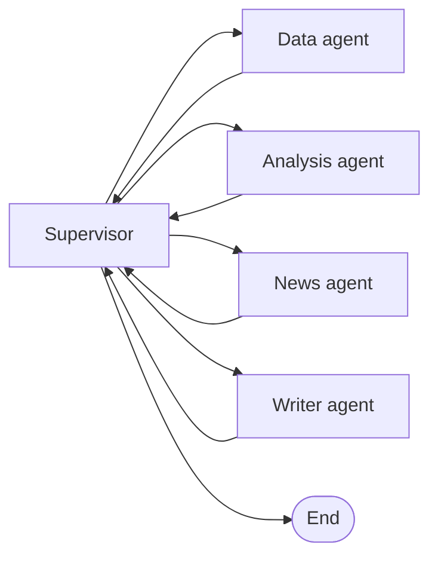

# StockSquad

Type an Indian large-cap company (for example "Tata Motors") and a team of AI agents writes a one-page research note:
business summary, key numbers vs peers, strengths, risks, news sentiment and a "worth investigating" conclusion.

Built with Python, LangGraph, Gemini (behind a swappable wrapper), yfinance and Streamlit.
**Research support only, not investment advice.**

## How it works



| Agent | One job | Uses LLM? |
|---|---|---|
| Supervisor | Find the company and peers, pick the next agent, retry a failure once, then mark it "unavailable" and carry on | No (rules) |
| Data | Fetch prices and 3-4 years of statements for the target and 2 peers (cached) | Only to trigger the tool call |
| Analysis | Net margin, operating margin, debt/equity, ROE, P/E, revenue growth YoY and CAGR, peer average | **No, plain Python** |
| News | Fetch headlines, judge sentiment, pick 3-5 headlines | Yes |
| Writer | Write short prose; Python adds the table, headlines and footer | Yes |

### Why the numbers can be trusted
1. All maths is in `stockteam/calc.py` (unit-tested). The LLM never calculates.
2. The data agent keeps the full data in Python. Only a tiny summary goes back to the LLM.
3. The peer table and headline list are inserted by Python, not typed by the LLM.
4. The **number guard** (`stockteam/guard.py`) rejects any number in the Writer's prose that the Analysis agent did not produce. The Writer is retried once, then a safe table-only note is used.
5. The News agent returns headline IDs, and Python copies the real title, source and date.

## Setup (Windows, VS Code terminal / PowerShell)

```powershell
py -3.11 -m venv .venv
.venv\Scripts\Activate.ps1          # if blocked: Set-ExecutionPolicy -Scope Process Bypass
pip install -r requirements.txt
copy .env.example .env              # then open .env and paste your GEMINI_API_KEY
streamlit run app.py
```

Quick command-line test without the web app: `python main.py "Infosys"`
Run the tests: `pytest`

## Project layout

```
app.py                 Streamlit front end
main.py                command-line runner
config.py              settings, supported companies, peer lists, pricing
stockteam/
  state.py             shared typed state + Pydantic models
  graph.py             LangGraph wiring, timing/token/tool logging, run_research()
  llm.py               swappable LLM wrapper (Gemini) with tool-calling loop
  tooling.py           @tool decorator and safe tool execution
  calc.py              all ratio calculations + markdown table
  guard.py             number guard for the Writer
  cache.py, logs.py    JSON cache, run logs
  tools/               companies.py, market_data.py, news.py (plain typed functions)
  agents/              supervisor, data, analysis, news, writer
tests/                 unit tests (no internet needed)
```

Each run appends a line to `logs/runs.jsonl` with time per agent, total latency, tokens, estimated cost and tool errors.

## Compare two models
Change `LLM_MODEL` in `.env` (or the sidebar box in the app), run the same company, and compare the lines in `logs/runs.jsonl`.
To add a different provider, subclass `LLMClient` in `stockteam/llm.py` and register it in `get_llm()`.

## Interview talking points
- **Why a rule-based supervisor?** Predictable, free and testable. An LLM router is an easy upgrade, but not needed for a fixed pipeline.
- **Why not let the LLM do the maths?** LLMs make arithmetic mistakes. Code is exact and testable.
- **How do you prevent hallucinated numbers?** Facts are separated from prose, plus the number guard and retry.
- **What does tool calling do here?** The model chooses to call typed tools. Tool results are logged, and the Data agent has a direct-call safety net if the model skips one.
- **How is failure handled?** Each agent is wrapped, so exceptions become a status. The supervisor retries once, then marks the part "unavailable" and the note says so.
- **What would you improve next?** Run Data and News in parallel, add an evaluation set, add more companies or a ticker search, compare models on accuracy, latency and cost.

## Known limitations
- yfinance is an unofficial Yahoo wrapper. It can rate-limit, and statements for some companies have gaps. Run `pip install -U yfinance` if it breaks.
- Tata Motors demerged on 1 Oct 2025: use TMPV (passenger vehicles incl. JLR) and TMCV (commercial vehicles). Older history may mix both.
- Bank and NBFC ratios (debt/equity, operating margin) are not comparable to other sectors. The note says so.
- Revenue CAGR uses up to 3 years. If fewer years exist, the table labels the shorter span (for example "(2y)").
- Only companies in `config.py` are supported.
